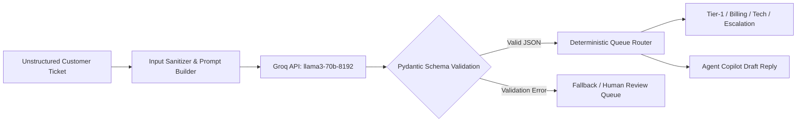

# Automated Support Ticket Triage & Routing Engine

> **Business Problem:** In high-volume customer operations, manual Tier-1 ticket triage creates routing bottlenecks, inconsistent severity scoring, and delayed SLA responses on compliance or churn-risk escalations. This engine converts unstructured customer messages into strictly validated JSON payloads for deterministic queue routing and instant draft responses.

[](YOUR_YOUTUBE_LINK_HERE)

-orange)


---

## System Architecture



## Operational Impact & Design Goals
* **Eliminates Manual Sorting:** Classifies intent, sentiment, urgency (1–5), and target department in under 800ms using Groq LPU inference.
* **Contract-First Reliability:** Enforces strict output typing via **Pydantic** so downstream webhooks (n8n, Zendesk, ServiceNow) never break on malformed LLM prose.
* **Reduces Handle Time (AHT):** Generates a context-aware, empathetic initial response draft so support reps edit rather than write from scratch.

---

## Sample Input & Validated Output

**Raw Customer Input:**
```text
"I've been charged twice for my monthly subscription this morning ($49.99 x 2) and now my card is overdrawn! Nobody is answering the phone. Fix this immediately or I'm filing a chargeback with my bank."
```

**Structured Engine Output (`TriageResult` Schema):**
```json
{
  "ticket_category": "Billing & Refunds",
  "urgency_score": 5,
  "customer_sentiment": "Critical / Churn Risk",
  "routing_queue": "Tier-2_Billing_Escalations",
  "requires_human_review": true,
  "extracted_entities": {
    "issue_type": "Duplicate Charge",
    "amount_mentioned": "$49.99",
    "chargeback_threat": true
  },
  "recommended_agent_action": "Verify transaction ledger for duplicate capture ID, issue immediate refund for second charge, and apply overdraft courtesy credit per SOP-204.",
  "draft_customer_reply": "I completely understand how frustrating it is to see a duplicate charge—especially when it impacts your bank balance. I have escalated your account to our Tier-2 Billing team right now to reverse the duplicate $49.99 transaction and follow up with confirmation within the hour."
}
```

---

## Tech Stack
* **Language:** Python 3.10+
* **Inference Engine:** Groq API (`llama3-70b-8192`) for sub-second structured generation
* **Schema & Validation:** Pydantic
* **UI / Interactive Harness:** Streamlit
* **Testing:** `pytest` unit test suite verifying schema compliance and edge-case inputs

---

## Known Limitations & Production Guardrails
1. **Human-in-the-Loop (HITL) Thresholds:** Any ticket scored at `urgency_score >= 4` or containing legal/chargeback keywords sets `requires_human_review: true` and suppresses automated outbound replies.
2. **PII Redaction Scope:** This portfolio build processes mock ticket strings directly. In a production enterprise environment, a Microsoft Presidio or regex PII-scrubbing middleware layer must mask SSNs, card numbers, and account PINs prior to external LLM API calls.
3. **Deterministic Fallback:** If the LLM fails Pydantic schema validation after retry, the engine defaults cleanly to a `Manual_Triage_Fallback` queue rather than dropping the ticket.

---

## Quickstart & Local Setup

```bash
# 1. Clone the repository
git clone [https://github.com/okrao/ticket_triage_engine.git](https://github.com/okrao/ticket_triage_engine.git)
cd ticket_triage_engine

# 2. Create and activate virtual environment
python3 -m venv venv
source venv/bin/activate

# 3. Install dependencies
pip install -r requirements.txt

# 4. Configure environment variables
cp .env.example .env
# Add your GROQ_API_KEY inside .env

# 5. Run unit tests
pytest

# 6. Launch the Streamlit interface
streamlit run app.py
```