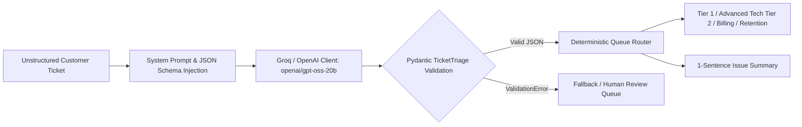

# Automated Support Ticket Triage & Routing Engine

> **Business Problem:** In high-volume customer operations, manual Tier-1 ticket triage creates routing bottlenecks, inconsistent severity scoring, and delayed SLA responses on compliance or churn-risk escalations. This engine converts unstructured customer messages into strictly validated JSON payloads for deterministic queue routing.

[](YOUR_YOUTUBE_LINK_HERE)


---

## System Architecture



## Operational Impact & Design Goals
* **Eliminates Manual Sorting:** Classifies `category`, `priority`, `sentiment`, `department_routing`, and a 1-sentence `summary` in under a second using high-speed LPU inference.
* **Contract-First Reliability:** Enforces strict output typing via **Pydantic (`TicketTriage` BaseModel)** so downstream automation workflows (n8n, Zendesk, ServiceNow) never break on malformed LLM prose.
* **Vendor-Agnostic Resilience:** Uses the OpenAI SDK with dynamic base URL routing to switch seamlessly between Groq (`https://api.groq.com/openai/v1`) and OpenAI endpoints.

---

## Sample Input & Validated Output

**Raw Customer Input (`Ticket #88492`):**
```text
"I have been trying to log into my account for three days and it keeps saying my password is wrong. I reset it twice and it STILL won't work. I have an automatic payment coming out tomorrow and if I get an overdraft fee because I can't check my balance I am going to cancel my entire account. Fix this immediately!"
```

**Structured Engine Output (`TicketTriage` Schema):**
```json
{
  "category": "Account Access",
  "priority": "Critical",
  "sentiment": "Angry",
  "department_routing": "Retention",
  "summary": "Customer is locked out after multiple password resets and threatening to cancel before an upcoming automatic payment causes an overdraft."
}
```

---

## Tech Stack
* **Language:** Python 3.10+
* **Inference Engine:** Groq API / OpenAI SDK (`openai/gpt-oss-20b` with `json_object` response format)
* **Schema & Validation:** Pydantic v2 (`BaseModel`)
* **Frontend:** Streamlit interactive triage console (`app.py`)
* **Testing:** `pytest` unit test suite (`test_triage.py`) verifying schema compliance and missing-credential handling

---

## Known Limitations & Production Guardrails
1. **Human-in-the-Loop (HITL) Escalation:** Tickets classified as `Critical` priority or routed to `Retention` require human review before any automated account changes or outbound commitments occur.
2. **PII Redaction Scope:** This portfolio build processes mock ticket strings directly. In production, a PII-scrubbing middleware layer masks email addresses, card numbers, and account IDs before calling external LLM APIs.
3. **Deterministic Fallback:** If an LLM output triggers a Pydantic `ValidationError`, the pipeline catches the exception and routes the ticket to a manual triage queue rather than dropping it.

---

## Quickstart & Local Setup

```bash
# 1. Clone the repository
git clone [https://github.com/okrao/ticket_triage_engine.git](https://github.com/okrao/ticket_triage_engine.git)
cd ticket_triage_engine

# 2. Create and activate virtual environment
python3 -m venv venv
source venv/bin/activate

# 3. Install dependencies
pip install -r requirements.txt

# 4. Configure environment variables
cp .env.example .env
# Add your GROQ_API_KEY (or OPENAI_API_KEY) inside .env

# 5. Run unit tests
pytest -v

# 6. Launch the Streamlit interface
streamlit run app.py
```